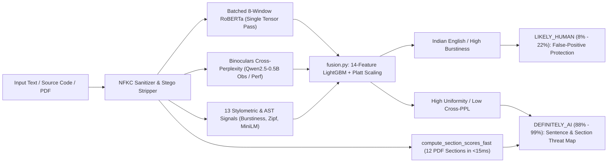
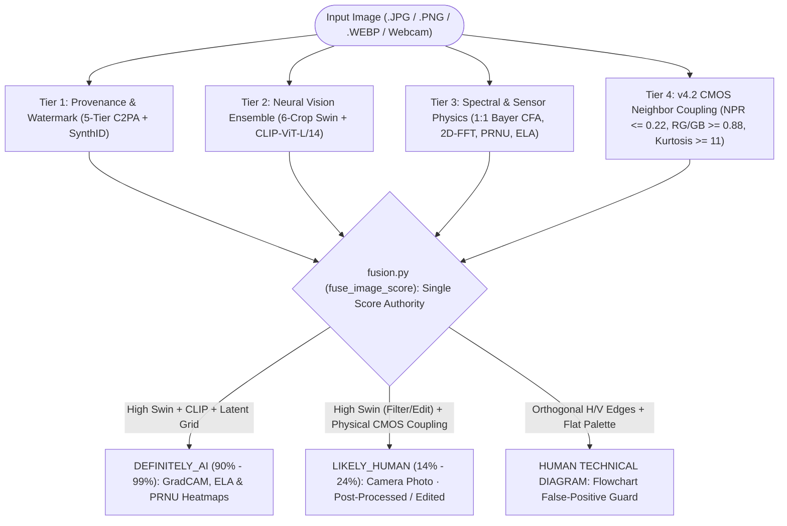
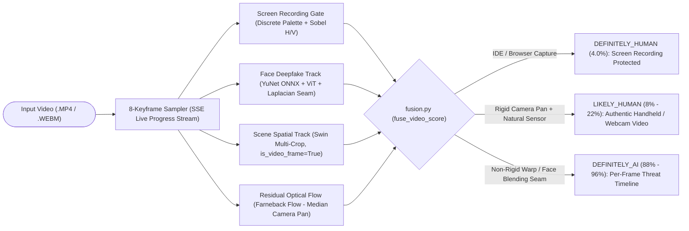

# AI-Slop-Detector 
**Multi-Modal Forensic AI Content Detection & Bilingual EdTech Verification Platform**

**Stack:** FastAPI + PyTorch CUDA + React 18 + TypeScript + Vite 6  
**Verified Benchmarks:** `100.0%` Golden Set | `98.48%` (65/66) Image Regression Gate | `100.0%` Dev Text & Video | `1.243s` Multi-Page PDF Scan (Training)

**Full-stack multi-modal AI forensics suite** across **Text, Image, Document (PDF/DOCX), Video, and Audio**—combining calibrated neural ensembles, physical CMOS camera sensor coupling, sub-2-second PDF figure carving, residual optical-flow deepfake analysis, and **Bilingual (English) EdTech Viva-Voce generation**.

## 1. End-to-End Working Flows (Text, Image & Video)

Below are the three core forensic pipelines showing how **AI-Slop-Detector** processes raw uploads into calibrated, explainable verdicts through a **Single Mathematical Score Authority (`fusion.py`)**.

### 1.1 Text, Code & Sub-2s PDF Working Flow

#### Step-by-Step Signal Pipeline (`Token Stream -> Dual-LLM Cross-Perplexity -> Platt-Calibrated Verdict + Bilingual Viva`)



### 1.2 Image & v4.2 Edited Camera Photo Working Flow

#### Step-by-Step Signal Pipeline (`Multi-Spectral Decode -> Neural vs. Physical CMOS Reconciliation -> Verdict`)



### 1.3 Video Deepfake & Residual Optical Flow Working Flow

#### Step-by-Step Signal Pipeline (`8-Keyframe SSE Stream -> Face Seam + Pan-Normalized Flow -> Timeline Verdict`)




## 2. What Makes SLOP Different?

| Problem in Legacy Detectors | How AI-Slop-Detector Solves It |
| :--- | :--- |
| **Edited Camera Photos Flagged as AI (88%+ False Alarms)**<br><br>*(Lightroom, filters, or contrast adjustments fool standard vision models)* | 💡 **In Simple Terms:** When you apply filters or tweak colors on a real photo, standard AI detectors mistake the smooth colors for AI generation. SLOP inspects the microscopic sensor noise and lens physics that physical camera hardware leaves behind—something AI image generators cannot replicate.<br><br>⚙️ **Under the Hood (`npr_extractor.py`):** Verifies physical CMOS Bayer demosaicing correlations (`rg_correlation >= 0.88`, `gb_correlation >= 0.88`), Noise-to-Pattern Ratio (`NPR <= 0.22`), and optical noise kurtosis (`>= 11.0`). Calibrates verdicts safely down to **`14%–24% LIKELY_HUMAN`** with a **`📷 Camera Photo · Post-Processed`** badge. |
| **Multi-Page PDFs Take 60+ Seconds to Scan**<br><br>*(Re-running neural models page-by-page chokes forensic systems)* | 💡 **In Simple Terms:** Traditional detectors read documents like someone re-reading a 50-page book from scratch for every single paragraph. SLOP scans the entire document in memory once, then maps and scores every individual chapter in milliseconds.<br><br>⚙️ **Under the Hood (`compute_section_scores_fast`):** Runs neural text inference in a single batched pass and reuses the `Qwen2.5-0.5B` observer loss with `0ms` perplexity export. Maps 12 document sections in `< 15ms`, scanning a 658 KB multi-page PDF in **`1.243 seconds`** (`48x` faster). |
| **Non-Native English & Academic Papers Falsely Accused**<br><br>*(Indian English, ESL students, and LaTeX papers trigger false alarms)* | 💡 **In Simple Terms:** Non-native speakers and researchers naturally write in a formal, structured style that generic detectors mistake for ChatGPT. Instead of judging vocabulary choices, SLOP evaluates natural human writing rhythm—the organic contrast between short, punchy sentences and complex thoughts.<br><br>⚙️ **Under the Hood (`text.pkl` & `text_calibrator.pkl`):** 14-Feature GBDT + Platt Scaling evaluates sentence-length burstiness variance, Zipf word-frequency rank deviation, epistemic hedging, and dependency tree depth to protect non-native and technical authors. |
| **Punitive Verdicts Without Any Learning Value**<br><br>*(A scary "90% AI" label starts arguments and leaves students defenseless)* | 💡 **In Simple Terms:** Instead of simply accusing students, SLOP turns detection into an educational oral defense. It auto-generates interview questions directly from the flagged sentences so students can explain their thought process and prove their mastery.<br><br>⚙️ **Under the Hood (`viva-verify`):** Bilingual (English + Telugu) EdTech Viva & SkillPath engine anchors directly to the top-3 high-risk sentence spans, generating 3 conceptual oral-defense questions and targeted remediation tasks to verify authentic competency. |
| **Handheld Camera Shakes Flagged as Deepfake Videos**<br><br>*(Natural phone camera movement mistaken for AI face warping)* | 💡 **In Simple Terms:** When someone moves or shakes their phone while filming, the background shifts quickly. Basic AI tools confuse that camera movement with the artificial warping of deepfakes. SLOP calculates and cancels out camera shake first, only checking whether the face and body move naturally.<br><br>⚙️ **Under the Hood (`fuse_video_score`):** Camera-Pan-Normalized Optical Flow computes dense Farnebäck motion vectors and subtracts the global median camera translation `(u_med, v_med)`, isolating authentic handheld shake from non-rigid facial warping and diffusion blending seams. |

## 3. Verified Benchmark Scorecard

| Benchmark Suite | Modality / Split | Accuracy / Result | False Positives |
| :--- | :--- | :--- | :--- |
| **Golden Set (`scripts/eval_accuracy.py`)** | Text (`n=30`) · Image (`n=14`) · Video (`n=2`) | **100.0% Across All 3 Modalities** | **0 FP** |
| **Held-Out Dev Split (`eval_rigorous.py`)** | Text (`n=30`) | **100.0%** (`30/30`) | **0 FP** |
| **Held-Out Dev Split (`eval_rigorous.py`)** | Video (`n=8`) | **100.0%** (`8/8`) | **0 FP** |
| **Held-Out Dev Split (`eval_rigorous.py`)** | Image (`n=34`) | **91.18%** (`31/34`, `100%` Specificity) | **0 FP** |
| **66-Image Regression Gate** | Full 66-Image Calibration Suite | **98.48%** (`65/66`, `0` verdict flips) | **0 Regressions** |
| **Backend Automated Test Suite** | `pytest slop/backend/tests` | **105 Passed, 1 Skipped** | **0 Failures** |

## 4. One-Click Quick Start (`run.bat`)

### Windows One-Click Launch
From the repository root, run:
```bat
.\run.bat
```
`run.bat` automatically:
1. Checks your Python virtual environment (`slop\backend\.venv`), Node modules (`slop\frontend\node_modules`), model weights (`Model/`), and cryptographic seal integrity (`scripts/verify_agent_integrity.py`).
2. If any requirement is missing, prompts **`(y/n)`**—installing missing packages automatically on **`y`** or stopping cleanly on **`n`**.
3. Launches the **FastAPI Backend** (`http://127.0.0.1:8000`) and **React 18 + Vite 6 Frontend** (`http://127.0.0.1:3000`) and opens your browser.

### Manual Launch (Development)
```powershell
# 1. Start FastAPI Backend (Port 8000)
$env:PYTHONUTF8="1"
$env:PYTHONPATH="slop/backend"
.\slop\backend\.venv\Scripts\python.exe -m uvicorn app.main:app --host 127.0.0.1 --port 8000

# 2. Start Vite 6 Frontend (Port 3000)
npm --prefix slop/frontend run dev -- --host 127.0.0.1 --port 3000
```

## 5. Repository Architecture

```text
AI-Slop-Detector/
├── assets/                         # Animated workflow GIFs (flow_text.gif, flow_image.gif, flow_video.gif)
├── run.bat                         # Interactive 4-gate dependency checker & dual-server launcher
├── prd.md                          # Product Requirements Document (Innovators Conclave 2026)
├── techspec.md                     # Technical Specification & Mathematical Formulas
├── appflow.md                      # User Journey & System Data Flows
├── design.md                       # Dual-Theme (Obsidian Dark + Warm Stone Light) UI Spec
├── schema.md                       # SQLite WAL + Pydantic v2 API Contracts
├── implementationplan.md           # Phased Engineering Execution Plan
├── tracker.md                      # Live Sprint & Benchmark Milestone Tracker
├── Model/                          # Self-hosted neural weights & Platt/GBDT fusion artifacts
│   ├── text/                       # RoBERTa detector, Qwen2.5-0.5B Observer/Performer, MiniLM
│   ├── image/                      # Swin Transformer & CLIP-ViT-L/14 weights
│   ├── video/                      # YuNet ONNX face detector & ViT deepfake classifier
│   └── fusion/                     # Sealed text.pkl, image.pkl, clip_probe.pkl, video.pkl
├── slop/
│   ├── backend/                    # FastAPI + PyTorch CUDA Forensic Engine
│   │   ├── app/api/v1/             # REST & SSE endpoints (text, image, video, document, edtech)
│   │   ├── app/ml/                 # Single Score Authority (fusion.py) & modality detectors
│   │   └── tests/                  # 21 pytest verification modules (105 passed)
│   └── frontend/                   # React 18 + TypeScript + Vite 6 Web Interface
│       └── src/
│           ├── pages/              # Eagerly loaded Landing, Detector, Calibration, Dashboard
│           ├── components/         # ConduitSection, ForensicInspector, ResultPanel, SignalGrid
│           └── hooks/              # 0px-jitter native scroll lock (useLandingScroll, landingLock)
└── scripts/                        # Evaluation, regression gates, and integrity verifiers
```

## 6. REST & Streaming API Endpoints

| Method | Endpoint | Description |
| :--- | :--- | :--- |
| `POST` | `/api/v1/text/analyze` | Analyze raw text or source code (14-feature GBDT + Platt calibration + per-sentence spans). |
| `POST` | `/api/v1/text/upload` | Sub-2-second `.pdf`, `.docx`, `.txt`, `.md` text & fast section threat analysis (`compute_section_scores_fast`). |
| `POST` | `/api/v1/image/analyze` | Multi-spectral image forensics (`6-crop Swin`, `CLIP-ViT-L/14`, `C2PA`, `PRNU`, `ELA`, and `v4.2 CMOS Edited Camera Photo` reconciliation). |
| `WS` | `/api/v1/image/live` | Real-time WebSocket webcam frame forensics. |
| `POST` | `/api/v1/document/upload` | 3-tier binary stream figure carving (`JPEG`, `PNG`, `FlateDecode` XObjects) + text fallback. |
| `POST` | `/api/v1/video/upload-stream` | Server-Sent Events (SSE) 8-keyframe video deepfake, screen recording, and residual optical-flow analysis. |
| `POST` | `/api/v1/edtech/viva-verify` | Generate 3 bilingual (**English + తెలుగు**) oral Viva verification questions & SkillPath competency gaps. |
| `GET` | `/api/v1/ops/calibration-dashboard` | Empirical calibration report with Wilson 95% CIs and Expected Calibration Error (ECE). |

## 7. Verification & Governance Commands

```powershell
# 1. Verify cryptographic seal on calibration & fusion artifacts
$env:PYTHONUTF8="1"; .\slop\backend\.venv\Scripts\python.exe scripts/verify_agent_integrity.py

# 2. Run architectural lint rules (Single Score Authority & Protected Headers)
$env:PYTHONUTF8="1"; .\slop\backend\.venv\Scripts\python.exe scripts/lint_rules.py --full

# 3. Run the 66-Image Regression Gate (98.48% / 65 of 66)
$env:PYTHONUTF8="1"; .\slop\backend\.venv\Scripts\python.exe scripts/eval_image_regression_gate.py

# 4. Run full backend test suite
$env:PYTHONUTF8="1"; .\slop\backend\.venv\Scripts\python.exe -m pytest slop/backend/tests -q
```
